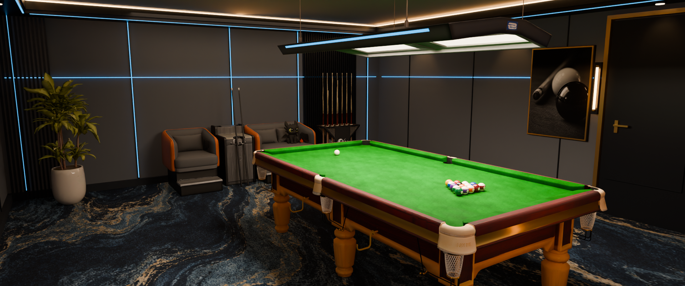

# Pool3D · 中式台球厅

Unity 离线台球玩法工程与 Blender 中式台球厅美术制作项目，包含球体运动、击球交互、规则、AI、场景资产准备，以及一支围绕开球制作的电影感宣传片。

## 开球宣传片

**[观看／下载完整宣传片](https://github.com/Alex-python-l/pool3d/raw/refs/heads/main/media/break_promo_1080p.mp4)** · [低清预览](media/break_preview_640.mp4)

22 秒，1920×1080，24 fps，宽银幕画面。镜头依次展示球厅环境、台呢与袋口、细杆前节瞄准、慢动作撞击、整桌俯拍散球和球厅氛围收束。采用 Blender Cycles 渲染、刚体模拟与原创合成音效。

> 视频展示的是 Blender 宣传片场景。最新 R13 台呢和完整球厅尚未正式接入 Unity，宣传片不是当前游戏实机录像。宣传片球杆按真实前节比例重做，只在击球镜头显示前段；游戏中的旧球杆仍待后续替换。

## 目录与入口

| 目录 | 内容 |
|---|---|
| [Game](Game/README.md) | 当前整合版：Unity 工程、C# 规则与物理、AI、交互、生成工具及检查记录 |
| [TableReplacement](TableReplacement/README.md) | 新球桌替换候选工程、几何配对检查和应用／恢复工具；保留待同步保护 |
| [Art/FeltR13](Art/FeltR13/README.md) | 最新球厅 Blender 场景、台呢厚度与纤维贴图、制作脚本与验证记录 |
| [Cinematic](Cinematic/production_notes.txt) | 开球动画、7 个机位、刚体代理、渲染与声音合成脚本及完整动画工程 |
| [media](media) | 正式宣传片、低清预览和封面 |
| [Docs](Docs) | 交接文档、接入计划及上传检查记录 |

## 打开游戏工程

1. 安装 **Unity 2022.3.62f2**，使用 Built-in 渲染管线、Linear 色彩空间。
2. 在 Unity Hub 中添加 `Game/UnityProject`，等待首次资源导入。
3. 打开 `Assets/Scenes/IntegratedOffline.unity`。

工程保留 8 球、9 球、本地双人、AI、拖动瞄准、后拉松手击球、加塞与自由球等既有逻辑。物理使用已有数值模拟和固定步长；不要另加一套球体 Rigidbody 来驱动相同对局。

本仓库保留 Assets、Packages、ProjectSettings 和资源 `.meta`，Library、Temp、Logs 等可重新生成的缓存不入库。现有编辑模式与数值检查记录在各工程 Docs 中；这次上传没有启动游戏或重新验收运行帧率。

## 打开美术和动画工程

- 球厅美术：`Art/FeltR13/luxury_pool_table_felt_depth_r13.blend`。
- 宣传片：`Cinematic/break_promo_working.blend`，Blender **5.1.0**，选择 `PROMO | cinematic scene`，时间线 1–528 帧，24 fps。
- 刚体源：`Cinematic/physics_source.blend`；240 fps、48 子步、100 次求解迭代，运动数据和重定时映射同目录保留。

贴图已打包进完整 Blender 工程。制作脚本保留原作者机器路径作为制作记录；换电脑执行前需将输出路径、Blender／Unity 路径调整为本地位置。先打开完整工程查看，无需重复运行一次性建模脚本。

Python 工具依赖见 `Game/Source/requirements.txt`；视频合成额外使用 NumPy、Pillow、imageio-ffmpeg。没有将 Python 虚拟环境或第三方工具安装目录放入仓库。

## 当前开发阶段

Unity 已有玩法整合工程；美术最新为 Blender R13。下一阶段需要重新导出最新环境，适配球体压绒、单位换算、球杆锚点与室内相机，再完成烘焙照明和 Windows 构建。

`TableReplacement/Docs/pending_blender_revision.json` 标记旧候选仍待同步。不要删除保护标记后直接套用旧候选，也不要将宣传片的静态观察球或球底绒丝导出成游戏环境。

## 来源与许可

第三方许可与来源保留在 [Game/ThirdPartyNotices](Game/ThirdPartyNotices) 和 [TableReplacement/ThirdPartyNotices](TableReplacement/ThirdPartyNotices)。本仓库为私有开发归档；第三方模型、恢复资源等继续受各自权利约束，没有为全部内容统一授予开源许可。
